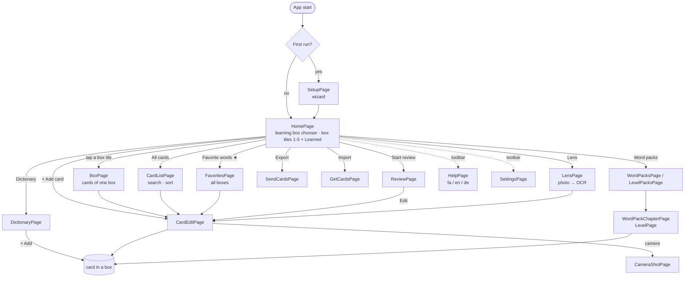
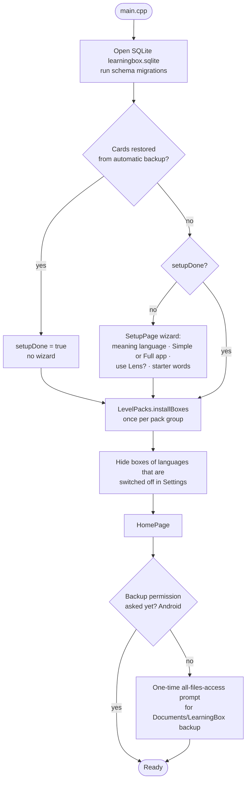
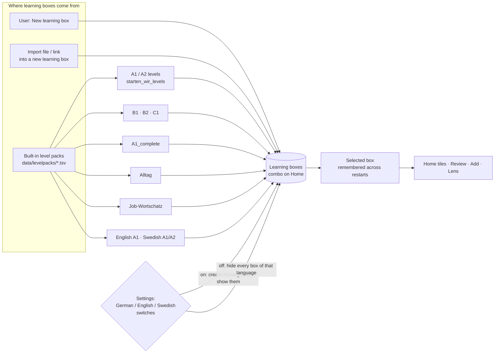
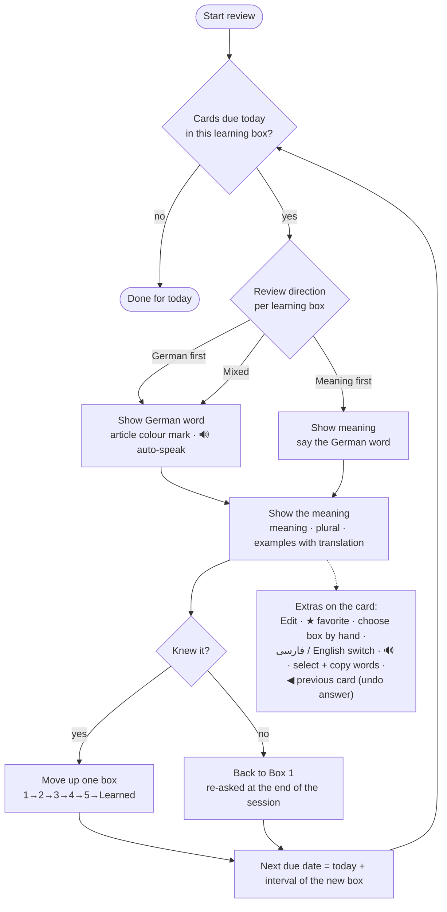
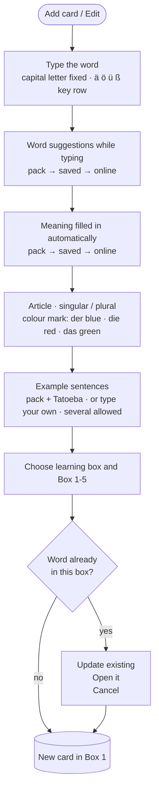
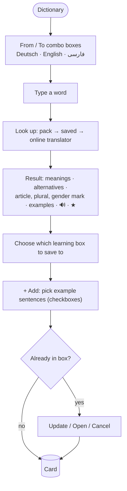
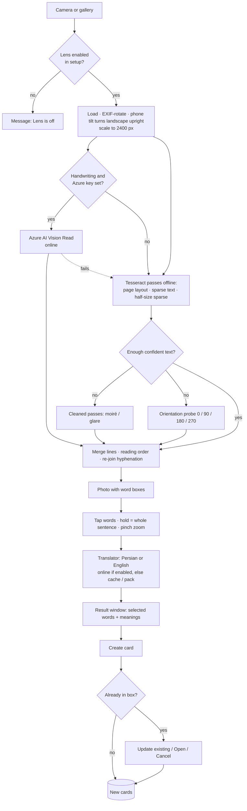
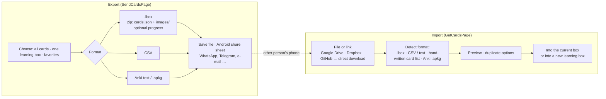
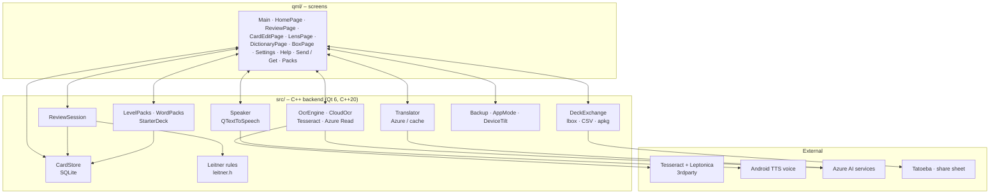

# LearningBox – Application flowcharts

Reference for how the app is put together and how the user moves through it. Companion to
[`ROADMAP.md`](../ROADMAP.md) (what is done / planned). The Mermaid charts render on GitHub and GitLab.

**Keep it current:** when a screen, flow or rule changes, edit the matching chart and update the date below.
Source of truth for navigation: `qml/Main.qml`, `qml/HomePage.qml`. Last checked against the code: **2026-11-08**.

Contents: [1 Screens](#1-screens-and-navigation) · [2 Start-up](#2-start-up) · [3 Learning boxes](#3-learning-boxes-and-level-packs) ·
[4 Review](#4-review-session-leitner) · [5 Add / edit card](#5-add-or-edit-a-card) · [6 Dictionary](#6-dictionary) ·
[7 Lens](#7-lens-photo--words--cards) · [8 Send and get cards](#8-send-and-get-cards) · [9 Data and backup](#9-data-storage-and-backup) ·
[10 Architecture](#10-layers)

---

## 1. Screens and navigation

One `StackView` in `Main.qml`. Home is the root page; every other page is pushed on top and closed with the back arrow.
The toolbar shows **? Help** on every page and **⚙ Settings** on every page except Settings itself.

---

## 2. Start-up

---

## 3. Learning boxes and level packs

A **learning box** (collection) is a separate Leitner system with its own Boxes 1–5 and Learned. Every query is scoped to the
selected learning box. Each box has a **learning language** (German, English, Swedish) and a **meaning language**
(Persian, English, German).

Pack file format and groups: `src/levelpack.cpp`, `src/levelpacks.cpp` (group 0 A1/A2, 1 B1–C1, 2 "complete", 3 Alltag, 4 Job-Wortschatz).
Each group is installed **once** (a settings flag per group), so a box the user deleted does not come back.

---

## 4. Review session (Leitner)

Boxes 1–5, then Learned (6). Intervals: **1 / 2 / 4 / 8 / 16 days** (`src/leitner.h`).

---

## 5. Add or edit a card

---

## 6. Dictionary

The Dictionary does **not** depend on the selected box: a German word is always a German card; "+ Add" goes to a German box.

---

## 7. Lens: photo → words → cards

Dependency check: when Tesseract or its language data is missing, the Lens page shows what is missing with download links.

---

## 8. Send and get cards

CSV import reads the first three columns: German, meaning, example (a header row such as `German` is skipped). Code: `src/deckexchange.*`, `src/exchange/deckformats.*`.

---

## 9. Data storage and backup

```mermaid
flowchart TD
    subgraph Phone["AppDataLocation on the phone"]
        DB[(learningbox.sqlite<br/>cards · learning boxes · progress)]
        TR[(translations.sqlite<br/>offline translation cache)]
        IMG[images/<br/>card pictures, 1024 px JPEG]
        TD[tessdata/<br/>OCR model copy]
        QS[QSettings<br/>language, switches, flags]
    end
    DB -->|automatic backup| BK[Documents/LearningBox]
    BK -->|after reinstall| RES[Restore on first start<br/>no setup wizard]
    RES --> DB
    NET{Online enabled<br/>in Settings?}
    NET -- yes --> AZT[Azure AI Translator free tier<br/>own key, optional]
    AZT --> TR
    NET -- no --> TR
```

---

## 10. Layers

Details per file: see the module table in [`ROADMAP.md`](../ROADMAP.md#2-modules--what-lives-where).

---

## Changelog of this document
| Date | Change |
|---|---|
| 2026-11-08 | First version: screens, start-up, boxes and packs, review, add / edit, dictionary, Lens, exchange, data, layers |
